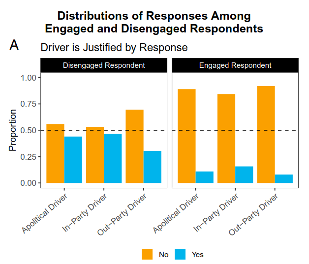

```{r setup, include=FALSE}
knitr::opts_chunk$set(echo = FALSE)
require(stringr)
require(data.table)
require(ggplot2)
require(magrittr)
```

<script type="text/x-mathjax-config">
MathJax.Hub.Config({
TeX: {extensions: ["cancel.js"]}
});
</script> 

## Objectives


### (1) Recap

- **bias**/**systematic error**
- **random** measurement error
- Reading Histograms


### (2) **Measurement Error**

- Why does it happen?
- What are the consequences?


# Example

---


<iframe width="560" height="315" src="https://www.youtube.com/embed/7PPRvTF12qc" title="YouTube video player" frameborder="0" allow="accelerometer; autoplay; clipboard-write; encrypted-media; gyroscope; picture-in-picture; web-share" referrerpolicy="strict-origin-when-cross-origin" allowfullscreen></iframe>

---


---


--- 


---

### Practice

```{r, echo = F, message=F}
require(ggplot2)
n = 10000
x1 = rnorm(n, 0, 0.5) - 1
x2 = rnorm(n, 4, 3)
x3 = rnorm(n, 0, 3)
plot_data = data.frame(Measure = rep(paste0("X",1:3), each = n), value = c(x1, x2, x3))
xlims = range(c(x1,x2, x3))
ggplot(plot_data, aes(value, fill = Measure)) + 
  geom_histogram(bins = 100, alpha = 0.5, position = 'identity') +
  labs(title = 'Measurement errors for different measures of variable:\n\"% Support for Political Violence" (X)') + xlab("Support for Violence (Observed) - Support for Violence (Actual)\nMeasurement Error Values") + ylab("# of Measurements") + 
  theme_bw() +
  geom_vline(xintercept = 0, colour = 'red') +
  geom_text(aes(x=-0.5, label="No Error", y=2000), colour="red", angle=90, size = 4, fontface = "plain") 
```

## Measurement Error: Random

**random measurement error**: errors that occur due to *random* features of measurement process. Even if observed values are sometimes wrong, they are, **on average**, correct

- Due to chance, we get values that are too high or too low
- There is no tilt one way or another (no bias): errors are only "noise"
- **random** here means: errors **unrelated** to true value; errors **equally likely** to be over- or under- estimate.
- In aggregate, values that are "too high" are balanced out by values that are "too low" compared to the truth

## Measurement Error: Bias

**bias** or **systematic measurement error**: error produced when our measurement procedure obtains values that are, **on average**, too high or too low (or incorrectly labelled) compared to the truth. 

- Key phrase is **"on average"**: error is not a one-off fluke, will happen **systematically** even if you repeat the measurement procedure.
- can have an *upward* (observed value too high) or *downward* (observed value too low) bias
- can occur for nominal/categorical values: e.g., systematically misclassifying undocumented migrants as legal
- **not** "politically" biased


# Dealing with Measurement Error

## How do we know...

...if there is measurement error?

We only observe what we observe, rarely the **true value**.

How do we know procedure does not return the **true** value? 

1. we understand **process** of observation to identify limitations and incentives that might lead to errors. $\to story$ 
2. comparison with known quantities or different measurement procedures (e.g., comparing scales) $\to ground \ truth$
3. we can do a new test that lets us see if *story* about measurement error is wrong $\to test \ story$

## What do we do...

...if there is measurement error?

Measurement error is everywhere. Does not mean we can say nothing about descriptive claims.

1. Depending on the descriptive claim, some types of measurement error are **tolerable**.
2. Depending on the **direction** of the measurement error, we may still be able to evaluate claims with **weak severity**
3. Depending on the **magnitude** of the measurement error, errors may be irrelevant to **weak severity**

## Goals:

1. Understand **reasons** measurement error occurs, so we can recognize it.
2. Recognize what the **pattern** of errors are: so we can identify the **type**, **direction** (if biased), and  **magnitude** of the error.
3. Guidelines for **how errors** affect **severity** of evidence.

# Why measurement error?

## Why bias happens:

Systematic Measurement Error (bias) arises from observations made by and of people:

- humans involved in observation process have misperceptions
- humans who are being observed have motives/incentives to misrepresent things
- humans use measurement tools for purposes other than intended


## Why Random Measurement Error?

- Imperfect memory (approximate guesses in survey/interviews)
- Mistakes (mis-click on a survey)
- "Arbitrary" changes in mood/concerns (for surveys)
    - e.g. rain might make you more angry and support government less
- Researcher interpretation 
    - e.g. flipping a coin when you can't tell how to classify country as a Democracy

Unless the error is literally generated at random, e.g. rolling dice, we only *assume*/*argue* that it is random


---

### Example: Political Violence

[Kalmoe and Mason](https://www.washingtonpost.com/politics/2021/01/11/what-you-need-know-about-how-many-americans-condone-political-violence-why/) measure support for political violence.

**Variable**: Percent of people who believe it is justified for people with similar political beliefs to use violence in politics.

**Measure**: 

- online survey of a national stratified sample of Americans. 
- **Ask**: "How much do you feel it is justified for [respondent's own party] to use violence in advancing their political goals these days?" **Options**: "Not at all", "a little", "a moderate amount", "a lot", "a great deal"
- Code "support" for political violence as answering "a little" to "a great deal"


## Example: Political Violence

> They find that ~30% of Americans "supported" political violence in 2020

Discuss: Likely to suffer from measurement error? What type? Why?

>- if bias, what direction?

## Example: Political Violence

In online surveys, many respondents are:

>- **not paying attention**: e.g 12 percent of online survey respondents (age 18-29) said they were licensed to operate a nuclear submarine $\to$ click choice at random
>- **unsure of how to answer**: people are unsure what question means by 'violence', 'justified', or 'political goals'. $\to$ pick an answer at random

>- Would random clicking lead to random error or bias?


## Example: Political Violence

In online surveys, many respondents are:

- **not paying attention**: e.g 12 percent of online survey respondents (age 18-29) said they were licensed to operate a nuclear submarine $\to$ click choice at random
- **unsure of how to answer**: people are unsure what question means by 'violence', 'justified', or 'political goals'. $\to$ pick an answer at random

>- 4 in 5 chance of randomly picking answer $\to$ "supports political violence". 


## Example: Political Violence

Just a story... is this measurement bias **real**? 

>- Don't know what is in people's hearts.
>- We can **observe** whether people who appear to be **not paying attention** answer differently than those **paying attention**


## Example: Political Violence

[Westwood et al (2022)](https://www.pnas.org/doi/pdf/10.1073/pnas.2116870119) ask similar questions on a survey:

- Participants read a short story about political violence (driver from Party A drove car into protestors from Party B)
- Asked about support for political violence
- Asked to recall the **state** in which the story took place (paying attention or not)

>- this examines the *story* about measurement bias

## Example: Political Violence



## Example: Political Violence

If the claim is that "At least one in three Americans think political violence is justified"...

And surveys find ~35% support for political violence.

>- How does the bias we've uncovered change what we can say using this evidence?
>- Does evidence meet **weak severity**?


(board)

# Measurement Error and Severity


## If errors, then need to ask...

1. Does the **source** of the error suggest a **systematic**  or **random** error?
2. Does the evidence using this measure appear to support or reject the claim?
4. If the error is a bias, what is the **direction** of the bias?  (upward?, downward?) 
1. Is the descriptive claim about absolute or relative amounts?
3. Is the **magnitude** of the error (random OR bias) likely to be large or small?


## Systematic Measurement Error

**When is it a problem?**

$1.$ **Evidence** and **bias** are in the **same direction**:

Evidence **supports** the claim and bias is **toward supporting** the claim. (fails weak severity)

or

Evidence **rejects** the claim and bias is **toward rejecting** the claim. (absence of evidence $\neq$ evidence of absence, not a severe test of claim being wrong)

## Systematic Measurement Error

Kennedy et al:

**Claim**: "Illegal immigrants commit violent crimes at higher rates than other Americans."

**Evidence**: Using Texas and Federal data on immigration status among convicted murderers, calculate rate of murder by immigration status: Higher for undocumented migrants.

**Bias**: Nowsrateh shows that Kennedy et al **double counted** undocumented murderers.

>- Evidence support the claim? Bias **toward** the claim?

(board)

## Systematic Measurement Error

When is it **not** a problem?

If the bias makes **harder** to support the claim, and we nevertheless find evidence in favor of the claim, this is **strong severity**. (Bias goes **against** supporting the claim)

## Systematic Measurement Error

When is it **not** a problem?

We claim that "At least 10 percent of Canadians believe that 'Men are naturally better leaders than women.'" and we observe using a survey:

> 15.5 percent of Canadians agreed or strongly agreed.

>- Does this support the claim?
>- What if we said that 5% of people hid their agreement (social desirability): what is the **direction** of the bias?
>- If that bias were real and we removed it: would evidence still support the claim?


## Systematic Measurement Error

**When is it a problem?**

$2.$ When the **magnitude** of the bias is **large** enough to change the conclusion from the evidence

- Kennedy et al measure found "more violent crime by undocumented"; correcting double counting found "less violent crime by undocumented". measurement bias $\to$ lack of weak severity
- When **magnitude** (size) of bias is **small**, less likely to happen.

## Systematic Measurement Error

**When is it a problem?**

$3.$ If claims are about **absolute** levels

Claims about **absolute** levels of, e.g.

- support for political violence (e.g. "more than a third of Americans support political violence")
- number/rate of crimes
 
... in a particular case.

$\to$ Any measurement bias must be inspected (as above)

---

**Claim**: Beliefs that "political violence is never justified" have declined.


Using same measurement from Kalmoe and Mason: does bias we saw earlier make it easier to accept this claim?

## Systematic Measurement Error

When is it **not** a problem?

**No problem** when:

1. Claim is about **relative** levels across cases and/or time
2. ***and*** Measurement bias is **the same** (across cases, over time)


## Random Error: When is it a problem?

**Claim**: "Support for political violence in the US is higher than 20%."

We a run a survey:

- We find that 21% of Americans support political violence.
- One data point.
- **random errors** of $> \pm1\%$ occur 90% the time

>- 45% chance that true support for political violence $< 20\%$. We could **easily** find support for claim when it is false.

## Random Error: When is it a problem?

$4.$ Random errors are a problem when **magnitude** is **large** and we make **few observations**

- less of a concern when random errors are **small** $\to$ random errors not big enough to change conclusion
- less of a concern when we have data on **many cases** $\to$ errors cancel out on average

## Conclusion:

**Measurement Error**

- know how to recognize both types
- what are the sources of these errors
- when are they a problem for **weak severity**?


