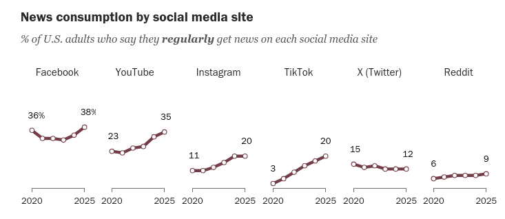
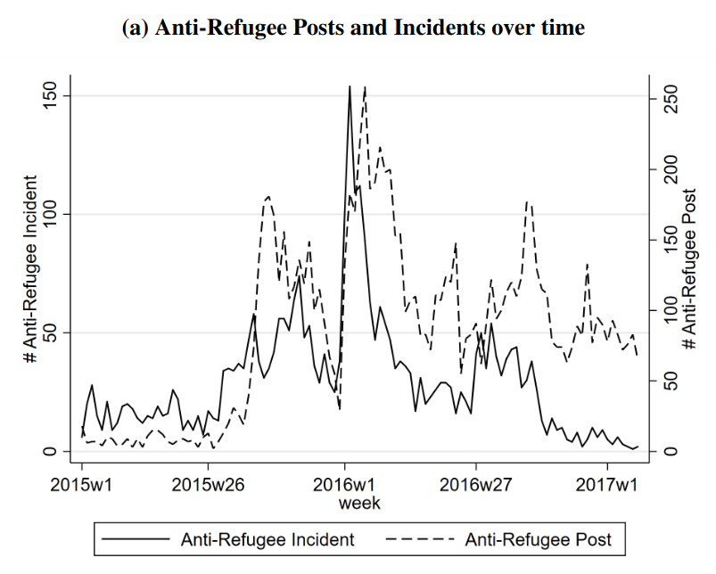
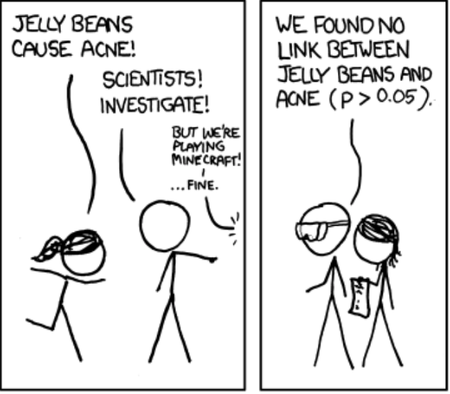
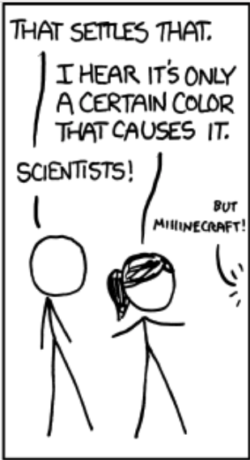
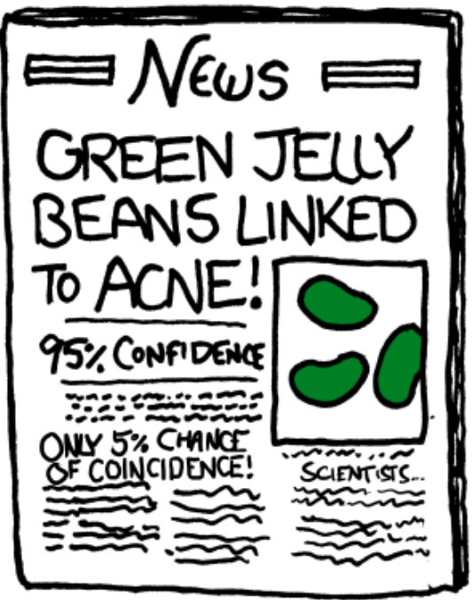
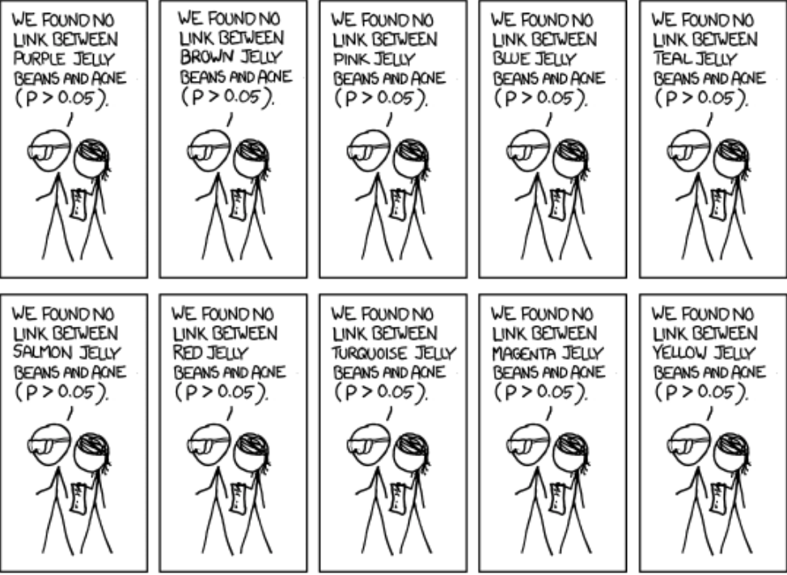
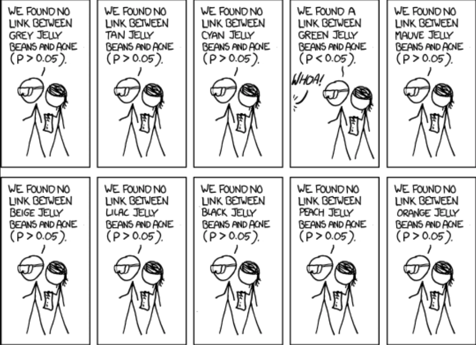

```{r setup, include=FALSE}
knitr::opts_chunk$set(echo = FALSE)
require(haven)
require(data.table)
require(ggplot2)
require(magrittr)
```

## Testing Causal Claims

### **1. Fundamental Problem of Causal Inference**

- independent/dependent variables
- solutions

### **2. Correlation**

- what is it?
- problems with correlation
- Random association


# An Example

---

<div class="centered">

</div>


## Social Media and Polarization:

**Claim:** "Reliance on social media for political information increases political polarization."


- What is the counterfactual claim?
- What potential outcomes does it imply?


## Independent/Dependent Variables

**Independent variable:**

The variable capturing the alleged **cause** in a causal claim.

- often denoted as $X$

**Dependent variable:**

The variable capturing the alleged **outcome** (what is affected) in a causal claim.

- often denoted as $Y$


---

**Dependent Variable:** Polarization

<div class="centered">

</div>


---

**Independent Variable:** News from Social Media




## Evidence for Causal Claims

Which potential outcome does this evidence give us? (Board)

Can this evidence tell us whether social media caused polarization?

## Evidence for Causal Claims

**Severity...**

Even if social media use **didn't** increase polarization...

Could we see this evidence (US has both social media use and polarization)?

>- If we want to find the **cause** of polarization, starting from case of **high polarization** like the US is **selection on dependent variable**

## Selection on the Dependent Variable

when attempting to provide evidence for causal claims, **selectively** observing cases based on the **outcome** they experience

- two problems $\to$ absence of weak severity

## Selection on the Dependent Variable

**Problem 1**: creates opportunity for "Texas Sharpshooter Fallacy"


"Fence" is case with outcome "high polarization"; "bullet holes" are attributes of that case

- can point to *any* attribute of the US and highlight as the "cause" (paint a bulls-eye)

---


## Selection on the Dependent Variable

**Problem 2**: Causality is counterfactual. Outcome should be different when **independent variable** changes. Selecting on dependent variable: never observe outcome under different exposure to the "cause".

- **outcome** (polarization) could have occurred **without** the alleged "cause" (social media). Without observing the counterfactual, we can't rule this out.


## Evidence for Causal Claims

Based on what we see in 2024...

$\text{Polarization}_{USA}(\text{Social Media}) = 54$ 

$\color{red}{\text{Polarization}_{USA}(\text{Social Media})} = \ \mathbf{????}$:

>- How could we know what this is?
>- We can **never know** what polarization would have been, absent social media usage

## What is the problem here?

### **Fundamental Problem of Causal Inference**

1. For the US, where people use social media: we can **only** observe the potential outcome of $\text{Polarization}_{USA}$ for where the value of $\text{Social Media} = High$: what **actually** happened.

2. We can **never observe** the other, **counterfactual**, potential outcomes of $\color{red}{\text{Polarization}_{USA}}$ where $\color{red}{\text{Social Media} = Low}$, because that was not what happened.

3. We can never **empirically** observe, for the US, whether $\text{Social Media}$ usage caused $\uparrow \text{Polarization}$.

## What is the problem here?

### **Fundamental Problem of Causal Inference**

1. By definition, $X$ causes $Y$ if the potential outcomes of $Y_i(X)$ were different if we changed $X$ for the exact same case.

2. For a specific case, we can **only** observe the potential outcome of $Y$ for the value of $X$ it **actually takes**. 

3. We **never observe** the **counterfactual** potential outcomes of $Y$ for different possible values of $X$ that the case did not experience.

4. We can never **empirically** observe, for a specific case, whether $X$ causes $Y$.

#


## You might be asking...

**I thought evidence for empirical claims based on *observing the world*?!**

**If we can never see the counterfactual... does this mean that *all* evidence for causal claims fails *weak severity*?**

**Are there "solutions" to this fundamental problem?**

## Solving the FPCI?

If getting news from social media increases polarization, it must true that:

$\color{red}{\mathrm{Polarization}_{USA}(\mathrm{Higher \ Social \ Media})} >$
$\mathrm{Polarization}_{USA}(\mathrm{High \ Social \ Media}) >$
$\color{red}{\mathrm{Polarization}_{USA}(\mathrm{Low \ Social \ Media})}$

<br>

In order to provide evidence for causal claims, we need to find ways around the FPCI:

- We need to find something we **can see** that can **stand in** for the missing **counterfactual**


## Social Media and Polarization

| $\mathrm{Country}_i$ | $\mathrm{Social \ Media}_i$ | $\mathrm{Polar.}_i(\mathrm{Low \ S.M.})$ | $\mathrm{Polar.}_i(\mathrm{High \ S.M.})$  |
|---|---------|--------|-------|
| USA | **High** | $\color{red}{\mathrm{Polar.}_{USA}(\mathrm{Low \ S.M.}) = ?}$ | $\mathrm{Polar.}_{USA}(\mathrm{High \ S.M.})$ |


<br>

How could we observe "$\color{red}{?}$", the unknown counterfactual?

>- We could to find **another country** where there **was lower social media use**

## Social Media and Polarization

We **cannot observe**: $\color{red}{\mathrm{Polar.}_{USA}(\mathrm{Low \ S. M.})}$

But we **can** observe, e.g.: $\mathrm{Polar.}_{Germany}(\mathrm{Low \ S. M.})$


---

| $\mathrm{Country}_i$ | $\mathrm{Social \ Media}_i$ | $\mathrm{Polar.}_i(\mathrm{Low \ S.M.})$ | $\mathrm{Polar.}_i(\mathrm{High \ S.M.})$  |
|---|---------|:--------:|:-------:|
| USA | **High** | $\color{red}{\mathrm{Polar.}_{USA}(\mathrm{Low \ S.M.})= ?}$ | $\mathrm{Polar.}_{USA}(\mathrm{High \ S.M.})$ |
| | | $\mathbf{\Uparrow}$ |  |
| Germany | **Low** | $\mathrm{Polar.}_{Germany}(\mathrm{Low \ S.M.})$ | $\color{red}{\mathrm{Polar.}_{Germany}(\mathrm{High \ S.M.})}$

---

If we **assume**:

$\mathrm{Polar.}_{Germany}(\mathrm{Low \ S.M.})$ $=$
$\color{red}{\mathrm{Polar.}_{USA}(\mathrm{Low \ S.M.})}$

Then, we can **empirically** test our causal claim

plugging in factual $Germany$ for the counterfactual $USA$

---

| $\mathrm{Country}_i$ | $\mathrm{Social \ Media}_i$ | $\mathrm{Polar.}_i(\mathrm{Low \ S.M.})$ | $\mathrm{Polar.}_i(\mathrm{High \ S.M.})$  |
|---|---------|:--------:|:-------:|
| USA | **High** | $\mathrm{Polar.}_{Germany}(\mathrm{Low \ S.M.})$  | $\mathrm{Polar.}_{USA}(\mathrm{High \ S.M.})$ |
| | | $\mathbf{\Uparrow}$ |  |
| Germany | **Low** | $\mathrm{Polar.}_{Germany}(\mathrm{Low \ S.M.})$ | $\color{red}{\mathrm{Polar.}_{Germany}(\mathrm{High \ S.M.})}$

---

```{r, echo = F, message = F, warning=F}
polarization = fread("./lecture-15-data.csv")
polarization[, state_use := state %>% stringr::str_replace("_", " ") %>% stringr::str_to_title()]
plot_order = c(12,6,1:5,7:11)

ggplot(polarization[plot_order[1]], aes(x = social_media, y = polarization, label = state_use)) +
  theme_bw() +
  geom_text() +
  xlim(c(20,60)) +
  ylim(c(25,60)) +
  xlab("X: % using Social Media for News") +
  ylab("Y: Affective Polarization")

```

48% of Americans report using social media for news.
$\mathrm{Polarization}_{USA}(\mathrm{Social \ Media \ News =48\% }) = 56$

---

```{r echo = F, message = F, warning=F}
ggplot(polarization[plot_order[1:2]], aes(x = social_media, y = polarization, label = state_use)) +
  theme_bw() +
  geom_text() +
  xlim(c(20,60)) +
  ylim(c(25,60)) +
  xlab("X: % using Social Media for News") +
  ylab("Y: Affective Polarization")

```

37% of Germans report using social media for news.
$\mathrm{Polarization}_{Germany}(\mathrm{Social \ Media \ News =37\% }) = 29$


---

```{r echo = F, message = F, warning=F}
ggplot(polarization[plot_order[1:3]], aes(x = social_media, y = polarization, label = state_use)) +
  theme_bw() +
  geom_text() +
  xlim(c(20,60)) +
  ylim(c(25,60)) +
  xlab("X: % using Social Media for News") +
  ylab("Y: Affective Polarization")

```

---

```{r echo = F, message = F, warning=F}
ggplot(polarization[plot_order[1:4]], aes(x = social_media, y = polarization, label = state_use)) +
  theme_bw() +
  geom_text() +
  xlim(c(20,60)) +
  ylim(c(25,60)) +
  xlab("X: % using Social Media for News") +
  ylab("Y: Affective Polarization")

```

---

```{r echo = F, message = F, warning=F}
ggplot(polarization[plot_order[1:5]], aes(x = social_media, y = polarization, label = state_use)) +
  theme_bw() +
  geom_text() +
  xlim(c(20,60)) +
  ylim(c(25,60)) +
  xlab("X: % using Social Media for News") +
  ylab("Y: Affective Polarization")

```

---

```{r echo = F, message = F, warning=F}
ggplot(polarization[plot_order[1:12]], aes(x = social_media, y = polarization, label = state_use)) +
  theme_bw() +
  geom_text() +
  xlim(c(20,60)) +
  ylim(c(25,60)) +
  xlab("X: % using Social Media for News") +
  ylab("Y: Affective Polarization") 

```

---

```{r echo = F, message = F, warning=F}
ggplot(polarization[plot_order[1:12]], aes(x = social_media, y = polarization, label = state_use)) +
  theme_bw() +
  geom_text() +
  xlim(c(20,60)) +
  ylim(c(25,60)) +
  xlab("X: % using Social Media for News") +
  ylab("Y: Affective Polarization") +
  geom_smooth(se = F, method = 'lm')

```


## Solving the FPCI

Every solution to the FPCI involves:

1. Comparing the **observed** values of outcome $Y$ in cases that **factually** have different values of cause $X$
      
2. **Assuming** that **factual** (observed) potential outcomes from one case as *equivalent to* **counterfactual** (unobserved) potential outcomes of another case.

>- The **observed** patterns of the association between the independent variable $X$ and dependent variable $Y$ we call **correlations**


## **Correlation**

**Correlation** is the association/relationship between the **observed**/**factual** values of $X$ (the independent variable) and $Y$ (the dependent variable)

- loosely: describes the **observed relationship** between $X$ and $Y$.
- formally: mathematical definitions for specific kinds of associations.


## **Correlation**

**All empirical evidence for causal claims** relies on **correlation** between the independent and dependent variables. 

But, you've all heard this:


---

```{r echo = F, message = F, warning=F}
ggplot(polarization[plot_order[1:12]], aes(x = social_media, y = polarization, label = state_use)) +
  theme_bw() +
  geom_text() +
  xlim(c(20,60)) +
  ylim(c(25,60)) +
  xlab("X: % using Social Media for News") +
  ylab("Y: Affective Polarization") +
  geom_smooth(se = F, method = 'lm')

```

>- Think about how we filled in the $\color{red}{\text{counterfactuals}}$ for the US: could anything go wrong?

# Correlation

## **Correlation**

Many different ways of assessing correlation, but shared attributes:

- correlations have a **direction**:
    - positive: $X\uparrow$, $Y\uparrow$ 
    - negative: $X\uparrow$, $Y\downarrow$ 
    
- correlations have **strength**:
    - **strong**: $X$ and $Y$ almost **always** move together 
    - **weak**: $X$ and $Y$ do not move together very much

---

Stronger 


---

Weaker

```{r echo = F, message = F, warning=F}
ggplot(polarization[plot_order[1:12]], aes(x = social_media, y = polarization, label = state_use)) +
  theme_bw() +
  geom_text() +
  xlim(c(20,60)) +
  ylim(c(25,60)) +
  xlab("X: % using Social Media for News") +
  ylab("Y: Affective Polarization")
```

## **Correlation**

Many different ways of assessing correlation, but shared attributes:

- correlations have a **direction**:
    - positive: $X\uparrow$, $Y\uparrow$ 
    - negative: $X\uparrow$, $Y\downarrow$ 
    
- correlations have **strength**:
    - **strong**: $X$ and $Y$ almost **always** move together 
    - **weak**: $X$ and $Y$ do not move together very much

- correlations have a **magnitude**: 
    - *how much* $Y$ changes with $X$. 

## **Correlation**

Many ways of examining correlations:

- scatterplots (point for each case on an x-y coordinates)
- bar plots (average Y for different values of X)
- trends (how do Y and X move together over time)
- tables of coefficients

---

Scatterplot

```{r echo = F, message = F, warning=F}
ggplot(polarization[plot_order[1:12]], aes(x = social_media, y = polarization, label = state_use)) +
  theme_bw() +
  geom_text() +
  xlim(c(20,60)) +
  ylim(c(25,60)) +
  xlab("X: % using Social Media for News") +
  ylab("Y: Affective Polarization")

```

---

Bar plot

```{r echo = F, message = F, warning = F, out.width="70%"}
anes = fread("./anes_2024.csv")
ggplot(anes, aes(x = as.factor(social_media), y = affective_polarization_pid)) +
geom_bar(stat = 'summary', fun.y = 'mean') + 
  xlab("Consumption of Social Media News: X") +
  ylab("Mean Partisan Affective Polarization: Y") +
  ggtitle("Social Media and Polarization") + 
  theme_bw() + 
  coord_cartesian(ylim=c(40,60))

```

Individual data on social media use and affective polarization from ANES 2024

---

Trend lines




## **Correlation**

### Formally...

common **mathematical** definition: correlation is the degree of **linear** association between $X$ and $Y$

- Takes values between $-1$ and $1$
- Values close to $1$ or $-1$ suggest **strong** degree of *linear* association
- Values close to $0$ suggest **weak** degree of *linear* association
- Value of correlation does **not** tell us **how much** $Y$ changes with $X$ (no magnitude)

## **Correlation**

### What is it?

**negative correlation**:  ($< 0$) values of $X$ and $Y$ move in opposite direction:

- higher values of $X$ appear with lower values of $Y$
- lower values of $X$ appear with higher values of $Y$

**positive correlation**: ($> 0$) values of $X$ and $Y$ move in same direction:

- higher values of $X$ appear with higher values of $Y$
- lower values of $X$ appear with lower values of $Y$

## **Correlation**


## **Correlation**

- It is possible to see **perfect correlation** but small (magnitude) change in $Y$ across $X$

- It is possible to see **weak correlation** but large (magnitude) change in $Y$ across $X$

- It is possible to see **perfect nonlinear relationship** between $X$ and $Y$ with $0$ correlation

## **Correlation**

**weak correlation**: values for $X$ and $Y$ do not cluster along line

**strong correlation**: values for $X$ and $Y$ cluster strongly along a line

**strength of correlation** does not determine the **slope** of line describing $X,Y$ relationship

**magnitude**: this is the **slope** of the line describing the $X,Y$ relationship. The larger the effect, the steeper the slope

---

```{r echo = F, message = F, warning=F}
ggplot(polarization[plot_order[1:12]], aes(x = social_media, y = polarization, label = state_use)) +
  theme_bw() +
  geom_text() +
  xlim(c(20,60)) +
  ylim(c(25,60)) +
  xlab("X: % using Social Media for News") +
  ylab("Y: Affective Polarization")

```

Correlation: $0.25$, Magnitude: $0.23$. Does this correlation prove using social media for news **causes** polarization? Why or why not?

---


```{r echo = F, message = F, warning = F}
cage_data = data.frame(cage_films = c(2,2,2,3,1,1,2,3,4,1,4),
                       pool_deaths = c(109, 102, 102, 98, 85, 95, 96, 98, 123, 94, 102))
ggplot(cage_data, aes(x =cage_films, y = pool_deaths)) + 
  geom_point(position = position_jitter(w = 0, h = 1)) + 
  geom_smooth(method = 'lm', fullrange = T, se = F) +
  theme_bw() +
  ggtitle("Factor X causes Pool Drownings?") +
  xlab("X") + 
  ylab("Pool Drownings per Year (US)") + 
  theme(plot.title = element_text(size = 24, face = "bold"),
        axis.title=element_text(size=14,face="bold"))

rho = cor(cage_data)[1,2] %>% round(2)

beta.hat = lm(pool_deaths ~ cage_films, cage_data)$coefficients[2] %>% round(2)

```

Correlation: `r rho`, Magnitude: `r beta.hat`. Does this correlation prove that X **caused** drownings? Why or why not?

---

```{r, echo = F, message = F, warning = F}
ggplot(cage_data, aes(x =cage_films, y = pool_deaths)) + 
  geom_point(position = position_jitter(w = 0, h = 1)) + 
  geom_smooth(method = 'lm', fullrange = T, se = F) +
  theme_bw() +
  ggtitle("Nic Cage films cause Pool Drownings") +
  xlab("Nic Cage Films per Year") + 
  ylab("Pool Drownings per Year (US)") + 
  theme(plot.title = element_text(size = 24, face = "bold"),
        axis.title=element_text(size=14,face="bold"))

```

Correlation: `r rho`, Magnitude: `r beta.hat`. Does this correlation prove that Nic Cage films **caused** drownings? Why or why not?

## Correlation

### **Two types of problems**

- **random association**: correlations between $X$ and $Y$ occur **by chance** and do not reflect *any* systematic relationship between $X$ and $Y$. (In the extreme, absolutely no relationship between $X$ and $Y$)

- **bias** (spurious correlation, **confounding**): $X$ and $Y$ are correlated but the correlation does not result from **causal** relationship between those variables

Avoiding these problems involves making **assumptions**: what are those assumptions? how plausible are they?

# Random Association 

## Correlation: Random association

<iframe width="560" height="315" src="https://www.youtube.com/embed/no_elVGGgW8?si=IWCa44aalTeXcc5C" title="YouTube video player" frameborder="0" allow="accelerometer; autoplay; clipboard-write; encrypted-media; gyroscope; picture-in-picture; web-share" referrerpolicy="strict-origin-when-cross-origin" allowfullscreen></iframe>

## Correlation: Random association

Arbitrary processes can make seemingly-strong patterns.

If you look long enough at pure chaos, you might find a strong correlation

- It could have happened by chance!
- So an observed correlation might not mean **any** relationship (e.g. Nic Cage)

[Arbitary Correlations](http://www.tylervigen.com/spurious-correlations)

## Random association: Statistics

To see that random patterns can emerge, I use random number generators to 

- **randomly** pick $5$ values of $X$ out of a "hat"
- **randomly** pick $5$ values of $Y$ out of a different "hat"

We can imagine these are the observed $X$ and $Y$ for $5$ cases. 


## Random association: Statistics

```{r, echo = F}
c= 0
counter = 0
while (c < 0.9) {
  x = rnorm(5)
  y = rnorm(5)
  c = cor(x,y)
  counter = counter + 1
}

plot(x,y, main = "5 cases\nX and Y chosen randomly")
text(mean(x), mean(y), labels = paste0("Correlation: ", round(c, 2)), adj = 0.5)

```

## Random association: Statistics

Could we find a strong correlation between $X$ and $Y$ (even if $X$ and $Y$ totally unrelated)? 

- if it is easy, then evidence fails weak severity requirement
- if it is difficult, then it passes

## Random association: Statistics


```{r, echo = F}
plot(x,y, main = "5 cases\nX and Y chosen randomly")
text(mean(x), mean(y), labels = paste0("Correlation: ", round(c, 2)), adj = 0.5)
```

$\#$ Tries to get correlation $> 0.9$: `r counter`

## Random association

What do we do about this problem?

- We can **never rule out** a chance correlation
- We *can* figure out **how likely** correlation occurred by chance.
- If chance correlation is very unlikely, then we set aside this concern (or indicate the "false positive rate" for this analysis)

## Random association: Statistics

### How?

1. Compute correlation of $X$ and $Y$
2. How **strong** is the correlation?
    - Patterns that are **stronger** are **less likely** to happen by chance
2. How many **cases** do we have?
    - Patterns with **many cases** are **less likely** to happen by chance
3. Assign a probability that observed correlation would have happened by chance, **assuming claim is wrong (no real correlation)**

## Random association: Statistics

This procedure works...

### **Assuming**...

1. we **correctly** describe the chance processes (save this for a stats class)
2. we don't misuse our statistical tests

## Random association: Statistics

```{r, echo = F}
c= 0
counter = 0
while (c < 0.9) {
  x = rnorm(10)
  y = rnorm(10)
  c = cor(x,y)
  counter = counter + 1
}

plot(x,y, main = "10 cases\nX and Y chosen randomly")
text(mean(x), mean(y), labels = paste0("Correlation: ", round(c, 2)), adj = 0.5)
```

Tries to get correlation $> 0.9$: `r counter `


## Random association: Statistics

```{r, echo = F}
c= 0
counter = 0
while (c < 0.9) {
  x = rnorm(15)
  y = rnorm(15)
  c = cor(x,y)
  counter = counter + 1
}

plot(x,y, main = "15 cases\nX and Y chosen randomly")
text(mean(x), mean(y), labels = paste0("Correlation: ", round(c, 2)), adj = 0.5)
```

Tries to get correlation $> 0.9$: `r sprintf("%.f",counter)`


## Random association: Statistics

```{r, echo = F}
c= 0
counter = 0
while (c < 0.45) {
  x = rnorm(15)
  y = rnorm(15)
  c = cor(x,y)
  counter = counter + 1
}

plot(x,y, main = "15 cases\nX and Y chosen randomly")
text(mean(x), mean(y), labels = paste0("Correlation: ", round(c, 2)), adj = 0.5)
```

Tries to get correlation $> 0.45$: `r counter`

## Random association: Statistics

**statistical significance**: 

> An indication of **how likely** it is that correlation we observe could have happened purely by chance.

> **higher** degree of statistical significance indicates correlation is **unlikely** to have happened by chance. (unlikely to observe evidence for the claim if claim is false)

## Random association: Statistics

$p$ **value**:

- probability of observing this correlation, **assuming** truth is a $0$ correlation between $X$ and $Y$.
- value between $0$ and $1$.
- **Lower** $p$-values indicate **greater** statistical significance

$p < 0.05$ often used as threshold for "significant" result. 

- but it is not a magic number
- we observe $p < 0.05$ by chance ($\frac{1}{20}$th of the time)
- even if significant, **magnitude** of effect may be small

## Random association: Statistics

$p$ **value**:

Advertised promise about weak severity: 

if we use this correlation as evidence in support of a claim, what is probability of accepting the claim **in error** (due to **random association**)?

>- only works if we don't abuse the tests

## Significant?



## Significant?



## Significant?


## What else do you want to know?



## Same interpretation?



## Same interpretation?



## Random association: Statistics

$p$ **value**:

Be wary of "$p$-hacking"/"snooping"

- $p$ values become meaningless if we look at many correlations, then only report the ones that are "significant".

### Why?

---

```{r, echo = F, message = F, message=F}
ggplot(cage_data, aes(x =cage_films, y = pool_deaths)) + 
  geom_point(position = position_jitter(w = 0, h = 1)) + 
  geom_smooth(method = 'lm', fullrange = T, se = F) +
  theme_bw() +
  ggtitle("Nic Cage films cause Pool Drownings") +
  xlab("Nic Cage Films per Year") + 
  ylab("Pool Drownings per Year (US)") + 
  theme(plot.title = element_text(size = 24, face = "bold"),
        axis.title=element_text(size=14,face="bold"))


p = cor.test(cage_data$cage_films, cage_data$pool_deaths)$p.value
```

Correlation: `r rho`, $p \le$ `r round(p,3)`: 1 in 40 chance is easy to find when you look at 25 thousand possible correlations.


---

1. Correlations can appear by chance
2. We can assess **probability** of observing correlation by chance if we know:
    - **strength** of correlation (close to $1,-1$)
    - **size** of the sample ($N$)
    - the **chance process** at work
3. $p$-values:
    - Obtained using mathematical formulae
    - Given same $N$, stronger correlation has lower $p$
    - Given same strength, correlation with more $N$ has lower $p$
    
## Random assocation: Recap

| Statistical<br>Significance | $p$-value | By Chance? | Why? | "Real"? |
|:----------------------------:|:-----------------:|:----------:|:-------------------------------:|:----------------:|
| Low | High $(p > 0.05)$ | Likely | small $N$<br>weak correlation | Probably **not** |
| High | Low $(p < 0.05)$ | Unlikely | large $N$<br>strong correlation | Possibly |


# Conclusion
    
---

```{r echo = F, message = F, warning = F}

ggplot(polarization[plot_order[1:12]], aes(x = social_media, y = polarization, label = state_use)) +
  theme_bw() +
  geom_text() +
  xlim(c(20,60)) +
  ylim(c(25,60)) +
  xlab("X: % using Social Media for News") +
  ylab("Y: Affective Polarization")

c_polarization = cor.test(polarization$social_media, polarization$polarization)


```

Correlation: `r c_polarization$estimate %>% round(2)`, $p \le$ `r c_polarization$p.value %>% round(3)`

Does social media used  **cause** polarization?

---

```{r echo = F, message = F, warning = F}
anes = fread("./anes_2024.csv")
ggplot(anes, aes(x = as.factor(social_media), y = affective_polarization_pid)) +
geom_bar(stat = 'summary', fun.y = 'mean') + 
  xlab("Consumption of Social Media News: X") +
  ylab("Mean Partisan Affective Polarization: Y") +
  ggtitle("Social Media and Polarization") + 
  theme_bw() + 
  coord_cartesian(ylim=c(40,60))

anes_polarization = cor.test(anes$social_media, anes$affective_polarization_pid)

```

Correlation: `r anes_polarization$estimate %>% round(2)`, $p \le$ `r anes_polarization$p.value %>% sprintf("%f0", .)`

Does social media used  **cause** polarization?

## Conclusion

$1.$ Correlation as "solution" to Fundamental Problem of Causal Inference

$2.$ Correlation suffers from two problems:

  - Random Association: assess $p$ values and statistical significance, based on assumptions about chance process
  - Bias: we call this "confounding", more on Thursday
    

