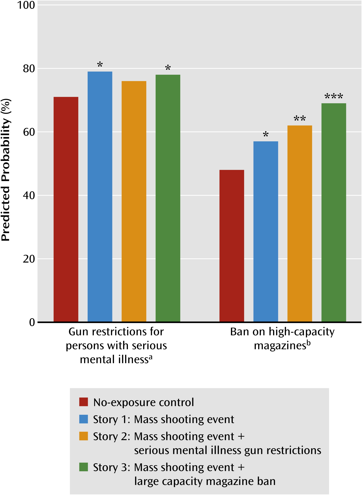
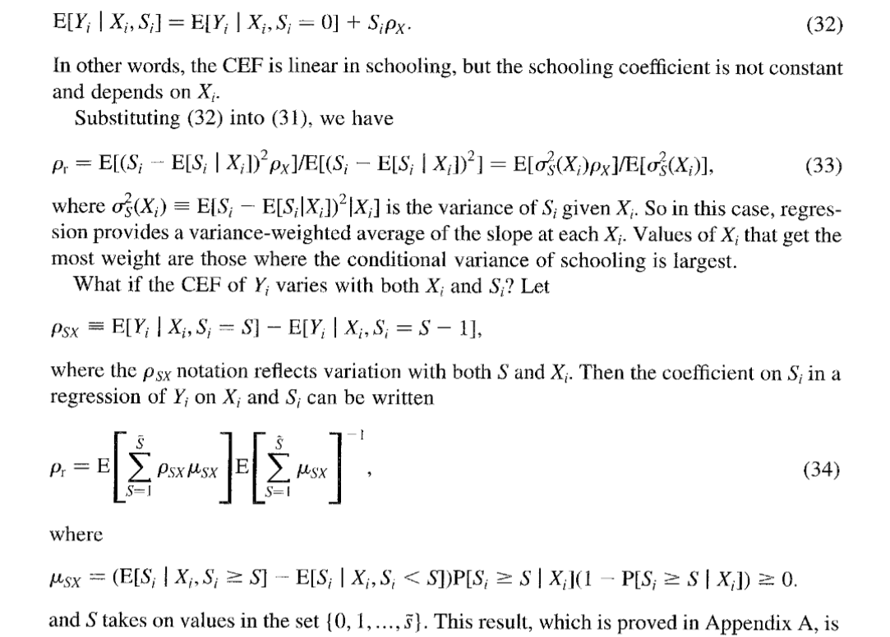
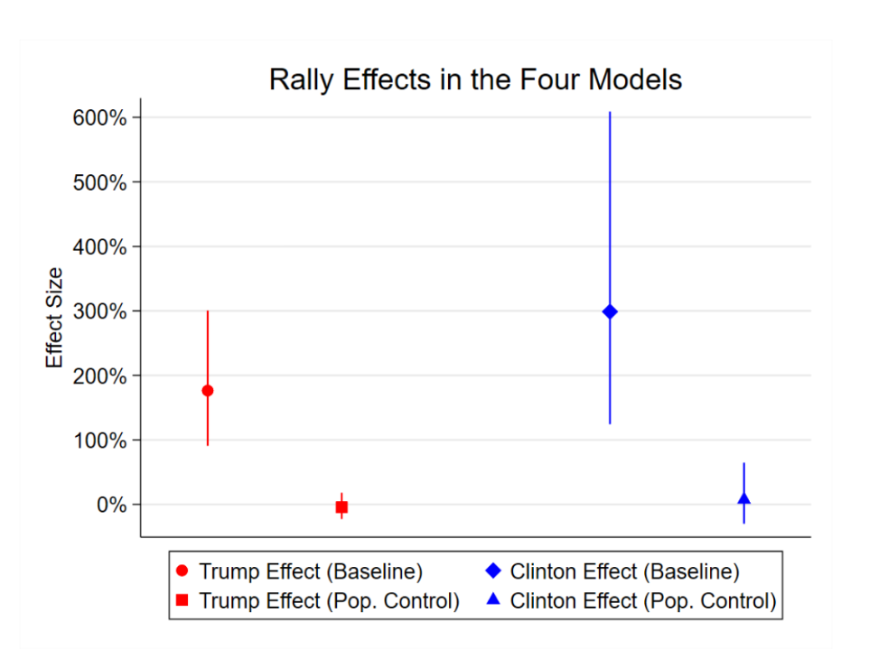

```{r setup, include=FALSE}
knitr::opts_chunk$set(echo = FALSE)
require(haven)
require(data.table)
require(ggplot2)
require(magrittr)
require(ggdag)
require(stringr)
```

# Correlation to Causation

## Solutions to Confounding

$1$. Conditioning:

  - What is it?
  - How does it work?
  - Assumptions?
  
$2$. "Design Based" approach

  - what is it?
  - how does it work?
  
# Recap

## Solutions to Confounding

Must ask...

- What **comparisons** between cases does it involve?
    - can you **recognize** this solution when it is described to you?
    - can you **describe** how to use this solution to test a particular causal claim?
- What **assumptions** are required for it to work?
- *How* does it "solve" confounding?
- What **trade offs** do we make?


---

### Experiment:

Does exposure to mass-shootings increase support for laws restricting access to guns? 

<br>


**What would an experiment look like?**: 

**What confounding is removed?**:

**What is assumed?**:

**Internal vs External validity?**

---

### Example:

Does exposure to mass-shootings increase support for laws restricting access to guns? ([McGinty et al 2013](https://psychiatryonline.org/doi/10.1176/appi.ajp.2013.13010014))


**What would an experiment look like?**: Recruit people into a survey. Randomly assign respondents to read/not read a news story about a mass shooting


**What confounding is removed?**: All confounding variables


**What is assumed?**: Random assignment, changing nothing other than $X$


**Internal vs External validity?**


---



---

| Solution | How Confounding<br>Solved | Which Confounding<br>Removed | Assumes | Internal<br>Validity | External<br>Validity |
|--------------------|------------------------------|------------------------------------------------|---------|----------------------|----------------------|
| Experiment | Randomization<br>Breaks $W \rightarrow X$ link | **All** confounding variables | $X$ is random;<br> Change only $X$ | High | Low | 


# Conditioning

---

Did Trump rallies cause hate crimes?

```{r echo = F, message = F, warning = F}
data = fread('./trump_rally_data.csv') %>% 
        .[, list(trump_count = sum(trumprallycount), hate_crimes = sum(incidentcount), l_pop = log_pop[1], pop = censuspop10[1]), by = fips]
data[trump_count > 3, trump_count := 3]
#data_g = data[, list(hate_crimes = mean(hate_crimes)), by = trump_count]
data[, hc_p_c := (hate_crimes / pop)*100000]
data[, any_trump := ifelse(trump_count >0, 1, 0)]
#g_data = data[, list(hate_crimes = mean(hate_crimes)), by = any_trump]
ggplot(data, aes(x = as.factor(any_trump), y = hc_p_c)) + 
  geom_bar(stat = 'summary', fun.y = 'mean') + 
  xlab("Trump Rallies (Any): X") +
  ylab("Mean Hate Crimes (Per 100k): Y") +
  ggtitle("Trump Rallies and Hate Crimes by County (2016)") + 
  theme_bw()
```

data from [Feinberg, Branton, and Martinez-Ebers ](https://lmas.unt.edu/sites/lmas.unt.edu/files/lmas/Hate%20Incidents%20Spike_0.pdf)

---

Possible confounders imagined by [Feinberg, Branton, and Martinez-Ebers ](https://lmas.unt.edu/sites/lmas.unt.edu/files/lmas/Hate%20Incidents%20Spike_0.pdf)

```{r, echo = F, warning = F, message = F}
dagify(hate_crime ~ rally + jewish + hate_group + crime + gop + univ + region,
      rally ~ jewish + hate_group + crime + gop + univ + region,
       exposure = "rally", 
       outcome = 'hate_crime',
       labels = c('rally' = "(X) Trump\nRally", 
                  'hate_crime' = "(Y) Hate Crimes",
                  'jewish' = '% Jewish',
                  'hate_group' = '# Hate\nGroups',
                  "crime" = "Crime Rate",
                  'gop' = 'Republican\nVoters',
                  'univ'= 'Univ.\nEducated',
                  'region' = "Region"
                  )) %>%
  tidy_dagitty(layout='circle') %>%
ggplot(aes(x = x, y = y, xend = xend, yend = yend)) +
  #geom_dag_node() +
  geom_dag_edges_link(mapping = aes(label = c(rep('',9), "?" ,rep('', 4))),
                      angle_calc = "along", label_dodge = unit(rep(1,15),'lines')) +
  geom_dag_text(mapping = aes(label = label), colour = 'black') +
  theme_dag() +
  scale_adjusted()
```


## Conditioning

### **conditioning**

when we observe $X$ and $Y$ for multiple cases, we examine the correlation of $X$ and $Y$ *within* groups of cases that are **the same** on confounding variables $W, etc. \ldots$

How does conditioning solve the problem? 

- Cases compared have **same values** on confounding variable(s) $W$
- In these groups, $W$ cannot affect $X$ or $Y$ (because $W$ is not moving, it can't move $X$ or $Y$)
- "Backdoor path" from $X$ to $Y$ is "blocked"

---

How does conditioning work?




---

Just kidding!


## Example: Conditioning

[Feinberg, Branton, and Martinez-Ebers ](https://lmas.unt.edu/sites/lmas.unt.edu/files/lmas/Hate%20Incidents%20Spike_0.pdf) compare hate crimes in counties with and without Trump rallies, but condition on (hold constant):

- percent Jewish
- number of hate groups
- crime rate
- 2012 Republican vote share
- percent university educated
- region

## Example: Conditioning

```{r, echo = F, warning = F, message = F}
dagify(hate_crime ~ rally + jewish + hate_group + crime + gop + univ + region,
      rally ~ jewish + hate_group + crime + gop + univ + region,
       exposure = "rally", 
       outcome = 'hate_crime',
       labels = c('rally' = "(X) Trump\nRally", 
                  'hate_crime' = "(Y) Hate Crimes",
                  'jewish' = '% Jewish',
                  'hate_group' = '# Hate\nGroups',
                  "crime" = "Crime\nRate",
                  'gop' = 'GOP\nVoters',
                  'univ'= 'Univ.\nEducated',
                  'region' = "Region"
                  )) %>%
  tidy_dagitty(layout='circle') %>%
ggplot(aes(x = x, y = y, xend = xend, yend = yend)) +
  #geom_dag_node() +
  geom_dag_edges_link(mapping = aes(label = c(rep("held constant", 9), "", rep("held constant", 4)), label_size = 2),
                      angle_calc = "along", label_dodge = unit(rep(1,14),'lines'),
                      edge_linetype = rep(c(3,3,3,3,3,3,3,3,1,3,3,3,3), each = 100),
                      arrow = grid::arrow(length=grid::unit(c(0,0,0,0,0,0,0,0,10,0,0,0,0), 'pt'), type = 'closed')) + 
  geom_dag_text(mapping = aes(label = label), colour = 'black') +
  theme_dag() +
  scale_adjusted()
```

## Example: Conditioning

| County | HC(Yes) <br> Y | HC(No) <br> Y | Rally (X) | Jewish<br>% | Hate<br>Groups | Crime<br>Rate | Rep.<br>% | Univ.<br> % | Region |
|--------|---------|--------|-------|----------|-------------|------------|--------|---------|--------|
| a      | $More$    | $\color{red}{Fewer}$  | Yes   | 2        | 3           | 15         | 53     | 38      | South  |
|        |     $\Downarrow$    |    $\Uparrow$    |       |          |             |            |        |         |        |
| b      | $\color{red}{More}$    | $Fewer$   | No    | 2        | 3           | 15         | 53     | 38      | South  


## Example: Conditioning

[Feinberg, Branton, and Martinez-Ebers ](https://lmas.unt.edu/sites/lmas.unt.edu/files/lmas/Hate%20Incidents%20Spike_0.pdf) find that, even after conditioning, Trump rallies increase the risk of hate crimes by 200%!

- Lots of news headlines [like this](https://www.vox.com/2019/3/24/18279807/trump-hate-crimes-study-white-nationalism)


## Example: Conditioning

```{r echo = F, message = F, warning = F}
data = fread('./trump_rally_data.csv') %>% 
        .[, list(clinton_count = sum(clintonrallycount), hate_crimes = sum(incidentcount), l_pop = log_pop[1], pop = censuspop10[1]), by = fips]
#data_g = data[, list(hate_crimes = mean(hate_crimes)), by = trump_count]
data[, hc_p_c := (hate_crimes / pop)*100000]
data[, any_clinton := ifelse(clinton_count >0, 1, 0)]

ggplot(data, aes(x = as.factor(any_clinton), y = hc_p_c)) + geom_bar(stat = 'summary', fun.y = 'mean') + 
  xlab("Clinton Rallies (Any): X") +
  ylab("Hate Crimes (per 100k): Y") +
  ggtitle("Clinton Rallies and Hate Crimes by County (2016):\nCorrelation") + 
  theme_bw()

```

## Example: Conditioning

[Economics PhD Candidates](https://github.com/lilleymatthew/Trump_Rallies_Replication_Materials/blob/master/Trump_Rallies_and_Hate_Crimes.pdf) show that **conditioning on the same variables**...

- **Clinton rallies** increased hate crimes by **nearly 250%!!**

>- What is going on here??

---

```{r, echo = F, warning = F, message = F}
data = fread('./trump_rally_data.csv') %>% 
        .[, list(rally_trump = trumpeverrally[1], 
                 hate_crimes_trump = ifelse(trumpeverrally[1] == 1,
                                      sum(incidentcount[trumprallyoccured ==1]) / sum(trumprallyoccured),
                                      sum(incidentcount)/length(incidentcount)
                                      ),
                 rally_clinton = clintoneverrally[1],
                 hate_crimes_clinton = ifelse(clintoneverrally[1] == 1,
                                      sum(incidentcount[clintonrallyoccured ==1]) / sum(clintonrallyoccured),
                                      sum(incidentcount)/length(incidentcount)
                                      ),
                 log_pop = log_pop[1]
                 ), by = fips] %>%
  melt.data.table(., id.vars = c('fips', 'log_pop'), 
                  measure = patterns("rally_", "hate_crimes_"), value.factor = F)
data[, Candidate := ifelse(variable %in% 1, 'Trump', 'Clinton')]  

ggplot(data, aes(x = log_pop, y = value1, color = Candidate )) + geom_jitter(height = 0.05, alpha = 0.1) +  geom_smooth(method = 'gam', se = FALSE) + 
  ylab("(X) Rallies (Any)") +
  xlab("(W) Log population") +
  ggtitle("Population (W) and Rallies (X) by County (2016):\nCorrelation") + 
  theme_bw()
```

---

```{r, echo = F, warning = F, message = F}

ggplot(data, aes(x = log_pop, y = value2, color = Candidate )) + geom_jitter(height = 0.05, alpha = 0.1) +  geom_smooth(method = 'gam', se = FALSE) + 
  ylab("(Y) Hate Crimes (per Month)") +
  xlab("(W) Log population") +
  ggtitle("Population (W) and Hate Crimes (Y) by County (2016):\nCorrelation") + 
  theme_bw()
```

---


```{r, echo = F, warning = F, message = F}
dagify(hate_crime ~ rally + jewish + hate_group + crime + gop + univ + region + pop,
      rally ~ jewish + hate_group + crime + gop + univ + region + pop,
       exposure = "rally", 
       outcome = 'hate_crime',
       labels = c('rally' = "(X) Trump\nRally", 
                  'hate_crime' = "(Y) Hate Crimes",
                  'jewish' = '% Jewish',
                  'hate_group' = '# Hate\nGroups',
                  "crime" = "Crime\nRate",
                  'gop' = 'GOP\nVoters',
                  'univ'= 'Univ.\nEducated',
                  'region' = "Region",
                  "pop" = "Population"
                  )) %>%
  tidy_dagitty(layout='circle') %>%
ggplot(aes(x = x, y = y, xend = xend, yend = yend)) +
  #geom_dag_node() +
  geom_dag_edges_link(mapping = aes(label = c(rep("held constant", 9), rep("",3), rep("held constant", 4)), label_size = 2),
                      angle_calc = "along", label_dodge = unit(rep(1,16),'lines'),
                      edge_linetype = rep(c(3,3,3,3,3,3,3,3,1,1,1,3,3,3,3), each = 100),
                      arrow = grid::arrow(length=grid::unit(c(0,0,0,0,0,0,0,0,10,10,10,0,0,0,0), 'pt'), type = 'closed')) + 
  geom_dag_text(mapping = aes(label = label), colour = 'black') +
  theme_dag() +
  scale_adjusted()
```

---

| County | HC(Yes) <br> Y | HC(No) <br> Y | Rally (X) | Jewish<br>% | Hate<br>Groups | Crime<br>Rate | Rep.<br>% | Univ.<br> % | Region | Pop. |
|--------|---------|--------|-------|----------|-------------|------------|--------|---------|--------|--------|
| a      | $More$    | $\color{red}{More}$  | Yes   | 2        | 3           | 15         | 53     | 38      | South  | **High** |
|        |     $\not\Downarrow$    |    $\not\Uparrow$    |       |          |             |            |        |         |        | |
| b      | $\color{red}{Fewer}$    | $Fewer$   | No    | 2        | 3           | 15         | 53     | 38      | South  | **Low** |

We would be wrong to use observed hate crimes in county $b$ (without a rally) to substitute in for counterfactual hate crimes in county $a$ (without a rally). 

Population differences $\to$ difference in hate crimes regardless of rally.

---

After also conditioning on population (a confounder): no correlation.



---

| Solution | How Confounding<br>Solved | Which Confounding<br>Removed | Assumes | Internal<br>Validity | External<br>Validity |
|--------------------|------------------------------|------------------------------------------------|---------|----------------------|----------------------|
| Experiment | Randomization<br>Breaks $W \rightarrow X$ link | **All** confounding variables | $X$ is random;<br> Change only $X$ | High | Low | 
| Conditioning | Hold confounders<br>constant | ? | ? | ? | High |


# Assumptions

## Conditioning Assumptions

In order to use conditioning to infer $X$ causes $Y$ if $X,Y$ correlated ...

### **Must Assume**

1. There are **no other confounding variables** (that you have not conditioned on)
    - i.e. you have conditioned on ALL confounding variables (backdoor paths)
    - sometimes called "ignorability assumption": you assume you can "ignore" other variables without confounding

**How can we tell whether this assumption is correct?**

DISCUSS WITH YOUR NEIGHBORS

## Conditioning Assumptions

1. Assume there are **no other confounding variables** (that you have not conditioned on)

- this can never be proven to be true: a "strong" assumption
- we can't know whether all confounders are blocked because we don't know true causal graph
- compare this against the assumption of randomization in experiments

## Example

In wake of mass shootings, we might ask:

**Do mass shooting events cause people to become more supportive of stricter gun control policies?**

## Example


## Example

[Newman and Hartman (2017)](https://www.cambridge.org/core/journals/british-journal-of-political-science/article/mass-shootings-and-public-support-for-gun-control/8F38356AF4DB22B8B7DF28052234FA09) examine whether exposure to mass shootings cause an increase in support for stricter gun control

- $Y$ large survey (CCES) asks: "In general, do you feel that laws covering the sale of firearms should be made more strict, less strict, or kept as they are?"
- $X$ "distance to nearest mass shooting in recent years"

>- **What might be possible confounding variables?**

## Example

```{r, echo = F, message=F, warning=F}
dagify(gun_control ~ shooting + policy + crime + movie,
       shooting ~ crime + mental + policy,
       exposure = "shooting", 
       outcome = 'gun_control',
       labels = c('shooting' = "(X)Mass\nShooting", 
                  'gun_control' = "(Y) Gun\nAttitudes",
                  'mental' = 'Mental\nHealthcare',
                  "crime" = "Crime",
                  'policy' = 'Gun\nLaws',
                  'movie' = "Loves\nJohn Wick")) %>%
  tidy_dagitty(layout='circle') %>%
ggplot(aes(x = x, y = y, xend = xend, yend = yend)) +
  #geom_dag_node() +
  geom_dag_edges_link() +
  geom_dag_text(mapping = aes(label = label), colour = 'black') +
  theme_dag() +
  scale_adjusted()
```

Which variables do we NEED to condition on? Which variables do we NOT NEED to condition on?

## Assumptions

**Must Assume**

1. There are **no other confounding variables** (that you have not conditioned on)

  - i.e. you have conditioned on ALL confounding variables
  - this can never be proven to be true: a "strong" assumption
    
But...  

  - don't need to condition on **ALL** variables that might affect $X$ or affect $Y$: only confounders.


## Example

```{r, echo = F, message=F, warning=F}
dagify(gun_control ~ shooting + med_2 + crime ,
       shooting ~ crime  + med_1,
       med_1 ~ policy,
       med_2 ~ policy,
       exposure = "shooting", 
       outcome = 'gun_control',
       labels = c('shooting' = "(X)Mass\nShooting", 
                  'gun_control' = "(Y) Gun\nAttitudes",
                  'med_1' = 'Gun Access',
                  "crime" = "Crime",
                  'policy' = 'Gun\nLaws',
                  'med_2' = "Move to/from\nGun State")) %>%
  tidy_dagitty(layout='circle') %>%
ggplot(aes(x = x, y = y, xend = xend, yend = yend)) +
  #geom_dag_node() +
  geom_dag_edges_link() +
  geom_dag_text(mapping = aes(label = label), colour = 'black') +
  theme_dag() +
  scale_adjusted()
```

Which variables do we NEED to condition on? Which variables do we NOT NEED to condition on?

## Assumptions

**Must Assume**

1. There are **no other confounding variables** (that you have not conditioned on)

  - i.e. you have conditioned on ALL confounding variables
  - this can never be proven to be true: a "strong" assumption
    
But...  

  - don't need to condition on **ALL** variables that might affect $X$ or affect $Y$: only confounders.
  - don't need to condition on **ALL** variables on a backdoor path. Just one variable per backdoor path is needed.

## Example

[Newman and Hartman (2017)](https://www.cambridge.org/core/journals/british-journal-of-political-science/article/mass-shootings-and-public-support-for-gun-control/8F38356AF4DB22B8B7DF28052234FA09):

Compare proximity to mass shooting and gun control attitudes, conditioning on (holding constant:

- **community level** factors: income, education, partisanship, racial composition, murder, firearms stores, population density, population
- **individual level** factors: education, income, age, gender, race, property ownership, having children, in military, military family, partisanship, ideology, religiosity, region of birth

>- Are there any potentially **really important** confounders that might not be included?

---


Proximity to mass shootings increases support for stricter gun laws... **assuming no other confounders**

## Assumptions

**Must Assume**

1. There are **no other confounding variables** (that you have not conditioned on)

But...  

  - don't need to condition on **ALL** variables that might affect $X$ or affect $Y$: only confounders.
  - don't need to condition on **ALL** variables on a backdoor path. Just one variable per backdoor path is needed.
  - we **can** give reasons/arguments for why any remaining confounding is likely small OR biased against the correlation (*small* bias may not be enough to change our conclusions, or bias is **against** our conclusions)


---

| Solution | How Confounding<br>Solved | Which Confounding<br>Removed | Assumes | Internal<br>Validity | External<br>Validity |
|--------------------|------------------------------|------------------------------------------------|---------|----------------------|----------------------|
| Experiment | Randomization<br>Breaks $W \rightarrow X$ link | **All** confounding variables | $X$ is random;<br> Change only $X$ | High | Low | 
| Conditioning | Hold confounders<br>constant | Only variables <br> conditioned on | Condition on all confounders | Low | High |


## Conditioning Assumptions

In order to infer $X$ causes $Y$ if $X,Y$ correlated after conditioning

### **Must Assume**

<ol start=2>
  <li> 
  **Variables used to condition** relationship between $X$ and $Y$ are **measured without error**.</li>
</ol>

- even **random measurement error** in confounding variables leads conditioning to not remove bias.
- Why? You are no longer comparing like-with-like.

## Conditioning Assumptions

Imagine we want to condition on gun ownership, when examining correlation of mass shootings and gun attitudes.

What if we measure **gun ownership** with random measurement error?

## What Happens When We Mismeasure Gun Ownership?

```{r, echo=FALSE}
person_use <- function(is_owner, mislabelled = FALSE, scale = 1) {
  ref <- if (is_owner) "#me-owner" else "#me-non"
  w <- round(30 * scale)
  h <- round(32 * scale)
  bg <- if (mislabelled) "border:1.5px dashed #64748b; border-radius:5px; background:#fef9c3;" else "border:1.5px solid transparent;"
  sprintf('<span style="padding:1px; %s display:inline-flex;"><svg width="%d" height="%d" viewBox="0 0 34 36"><use href="%s"/></svg></span>', bg, w, h, ref)
}

make_grid <- function(n_o, n_n, owner_box = NA, scale = 0.88) {
  o_html <- if (n_o > 0) paste(replicate(n_o, person_use(TRUE, identical(owner_box, FALSE), scale)), collapse = "") else ""
  n_html <- if (n_n > 0) paste(replicate(n_n, person_use(FALSE, identical(owner_box, TRUE), scale)), collapse = "") else ""
  paste0(o_html, n_html)
}

make_panel <- function(id, no, fo, nn, fn, bg, bd, col, txt) {
  box <- function(title, counts, is_o, color_txt, border_col) {
    pct <- if (is_o) round(counts[1] / sum(counts) * 100) else round(counts[2] / sum(counts) * 100)
    lbl <- if (is_o) "True Owners" else "True Non-Owners"
    sprintf('<div style="background:#fff; border:1px solid %s; border-radius:8px; padding:6px;">
      <div style="font-weight:bold; font-size:12px; text-align:center; color:#0f172a;">%s</div>
      <div style="font-size:11px; color:%s; text-align:center; margin-bottom:4px;"><b>%d O / %d N</b> (%d%% %s)</div>
      <div style="display:flex; flex-wrap:wrap; gap:2px; justify-content:center; min-height:70px; align-content:flex-start;">%s</div>
    </div>', border_col, title, color_txt, counts[1], counts[2], pct, lbl, make_grid(counts[1], counts[2], is_o, 0.88))
  }
  sprintf('<div class="me-panel me-panel-%s">
    <div style="display:grid; grid-template-columns:1fr 1fr; gap:12px;">
      <div style="background:#fff7ed; border:2px dashed #ea580c; border-radius:10px; padding:8px 10px;">
        <div style="font-weight:bold; color:#9a3412; font-size:13.5px; text-align:center; margin-bottom:6px;">Observed &ldquo;Gun Owners&rdquo;</div>
        <div style="display:grid; grid-template-columns:1fr 1fr; gap:8px;">%s%s</div>
      </div>
      <div style="background:#eff6ff; border:2px dashed #2563eb; border-radius:10px; padding:8px 10px;">
        <div style="font-weight:bold; color:#1e40af; font-size:13.5px; text-align:center; margin-bottom:6px;">Observed &ldquo;Non-Owners&rdquo;</div>
        <div style="display:grid; grid-template-columns:1fr 1fr; gap:8px;">%s%s</div>
      </div>
    </div>
    <div style="margin-top:10px; padding:8px 12px; border-radius:8px; font-weight:bold; text-align:center; font-size:13px; background:%s; border:1px solid %s; color:%s;">%s</div>
  </div>',
  id,
  box("Near Shooting", no, TRUE, "#c2410c", "#fed7aa"),
  box("Far From Shooting", fo, TRUE, "#c2410c", "#fed7aa"),
  box("Near Shooting", nn, FALSE, "#1d4ed8", "#bfdbfe"),
  box("Far From Shooting", fn, FALSE, "#1d4ed8", "#bfdbfe"),
  bg, bd, col, txt)
}

knitr::raw_html(paste0('
<style>
  #me-demo .me-row-label { font-size:11.5px; font-weight:800; letter-spacing:0.08em; text-transform:uppercase; color:#475569; margin:8px 0 5px 0; }
  #me-demo input.me-radio { display:none; }
  #me-demo label.me-btn { display:inline-block; padding:6px 12px; border-radius:6px; border:1px solid #cbd5e1; background:#fff; color:#0f172a; font-weight:bold; cursor:pointer; font-size:13px; margin-right:6px; user-select:none; }
  #me-demo #me-err-0:checked ~ .me-toolbar label[for="me-err-0"] { background:#16a34a; color:#fff; border-color:#16a34a; }
  #me-demo #me-err-25:checked ~ .me-toolbar label[for="me-err-25"] { background:#dc2626; color:#fff; border-color:#dc2626; }
  #me-demo .me-panel { display:none; }
  #me-demo #me-err-0:checked ~ .me-panel-0 { display:block; }
  #me-demo #me-err-25:checked ~ .me-panel-25 { display:block; }
</style>
<svg style="display:none;" aria-hidden="true"><defs>
  <symbol id="me-owner" viewBox="0 0 34 36">
    <circle cx="14" cy="5.8" r="3.6" fill="#ea580c"/>
    <rect x="10.8" y="10.5" width="6.4" height="11.5" rx="3.0" fill="#ea580c"/>
    <line x1="12.4" y1="21" x2="10.5" y2="33" stroke="#ea580c" stroke-width="2.9" stroke-linecap="round"/>
    <line x1="15.6" y1="21" x2="17.5" y2="33" stroke="#ea580c" stroke-width="2.9" stroke-linecap="round"/>
    <path d="M11.5 12.2 L8.2 16.5 L12.2 17.8" stroke="#ea580c" stroke-width="2.5" stroke-linecap="round" stroke-linejoin="round" fill="none"/>
    <path d="M16.5 12.2 L19.2 16.2 L21.2 14.0" stroke="#ea580c" stroke-width="2.5" stroke-linecap="round" stroke-linejoin="round" fill="none"/>
    <g transform="rotate(-24 16 16)"><path d="M5,14.5 L10,15.0 L19.5,15.0 L19.5,15.4 L29,15.4 L29,16.5 L19.5,16.5 L19.5,17.2 L16.2,17.2 L15.5,20.2 L13.8,20.2 L14.2,17.2 L10,17.2 L5,18.2 Z" fill="#1e293b" stroke="#ffffff" stroke-width="0.6" stroke-linejoin="round"/></g>
    <circle cx="12.2" cy="17.8" r="1.4" fill="#ea580c"/>
    <circle cx="21.2" cy="14.0" r="1.4" fill="#ea580c"/>
  </symbol>
  <symbol id="me-non" viewBox="0 0 34 36">
    <circle cx="14" cy="5.8" r="3.6" fill="#2563eb"/>
    <rect x="10.8" y="10.5" width="6.4" height="11.5" rx="3.0" fill="#2563eb"/>
    <line x1="12.4" y1="21" x2="10.5" y2="33" stroke="#2563eb" stroke-width="2.9" stroke-linecap="round"/>
    <line x1="15.6" y1="21" x2="17.5" y2="33" stroke="#2563eb" stroke-width="2.9" stroke-linecap="round"/>
    <path d="M11.2 12.2 L8.5 20.5" stroke="#2563eb" stroke-width="2.6" stroke-linecap="round" fill="none"/>
    <path d="M16.8 12.2 L19.5 20.5" stroke="#2563eb" stroke-width="2.6" stroke-linecap="round" fill="none"/>
  </symbol>
</defs></svg>
<div id="me-demo" style="font-family:-apple-system,BlinkMacSystemFont,sans-serif; font-size:13px; color:#0f172a; line-height:1.3;">
  <input class="me-radio" type="radio" name="me_err" id="me-err-0" checked>
  <input class="me-radio" type="radio" name="me_err" id="me-err-25">
  <div class="me-toolbar" style="display:flex; justify-content:space-between; align-items:center; margin-bottom:8px; flex-wrap:wrap; gap:8px;">
    <div><label class="me-btn" for="me-err-0">0% Error</label><label class="me-btn" for="me-err-25">25% Random Error</label></div>
    <div style="display:flex; gap:12px; font-size:12.5px; align-items:center; flex-wrap:wrap;">
      <span style="display:inline-flex; align-items:center; gap:4px;">', person_use(TRUE, FALSE, 0.8), '<b>True Gun Owner</b></span>
      <span style="display:inline-flex; align-items:center; gap:4px;">', person_use(FALSE, FALSE, 0.8), '<b>True Non-Owner</b></span>
      <span style="color:#64748b; font-size:11.5px;">(Yellow box = mislabelled)</span>
    </div>
  </div>
  <div class="me-row-label">Truth</div>
  <div style="display:grid; grid-template-columns:1fr 1fr; gap:12px;">
    <div style="background:#f8fafc; border:1px solid #cbd5e1; border-radius:10px; padding:8px 10px;">
      <div style="font-weight:bold; font-size:13.5px; text-align:center; margin-bottom:2px;">Near Shooting (N = 12)</div>
      <div style="font-size:12px; color:#475569; text-align:center; margin-bottom:6px;">4 True Owners (33%) &middot; 8 True Non-Owners (67%)</div>
      <div style="display:flex; flex-wrap:wrap; gap:3px; justify-content:center;">', make_grid(4, 8, NA, 0.95), '</div>
    </div>
    <div style="background:#f8fafc; border:1px solid #cbd5e1; border-radius:10px; padding:8px 10px;">
      <div style="font-weight:bold; font-size:13.5px; text-align:center; margin-bottom:2px;">Far From Shooting (N = 12)</div>
      <div style="font-size:12px; color:#475569; text-align:center; margin-bottom:6px;">8 True Owners (67%) &middot; 4 True Non-Owners (33%)</div>
      <div style="display:flex; flex-wrap:wrap; gap:3px; justify-content:center;">', make_grid(8, 4, NA, 0.95), '</div>
    </div>
  </div>
  <div class="me-row-label" style="margin-top:10px;">Observed (Holding Gun Ownership Constant)</div>',
  make_panel("0", c(4,0), c(8,0), c(0,8), c(0,4), "#f0fdf4", "#16a34a", "#166534",
    "With 0% error, Observed &ldquo;Owners&rdquo; are 100% True Owners in both Near and Far (and Observed &ldquo;Non-Owners&rdquo; are 100% True Non-Owners). We compare like-with-like!"),
  make_panel("25", c(3,2), c(6,1), c(1,6), c(2,3), "#fef2f2", "#dc2626", "#991b1b",
    "With 25% random error, Observed &ldquo;Owners&rdquo; are 60% True Owners (Near) vs. 86% (Far), and Observed &ldquo;Non-Owners&rdquo; are 86% True Non-Owners (Near) vs. 60% (Far). Not like-with-like!"),
'</div>'))
```


## Conditioning Assumptions

In order to infer $X$ causes $Y$ if $X,Y$ correlated after conditioning

### **Must Assume**

<ol start=3>
  <li> 
  We can **find** cases that are **the same** on confounding variables $W$ and different in $X$.</li>
</ol>

## Example:

Let's say we want to examine the effect of laws restricting gun ownership on gun violence across **countries**:

What are some factors that might affect strictness of gun regulation and gun violence?

---

```{r, echo = F, message=F, warning=F}
dagify(gun_control ~ unemployment + inequality + welfare + capacity + slavery + settler  ,
       shooting ~ gun_control + unemployment + inequality + welfare + capacity + slavery + settler ,
       exposure = "gun_control", 
       outcome = 'shooting',
       labels = c('shooting' = "(Y)Gun\nViolence", 
                  'gun_control' = "(X) Gun\nRestrictions",
                  'unemployment' = 'Unemployment',
                  "inequality" = "Inequality",
                  'welfare' = 'Welfare\nSpending',
                  'capacity' = "State\nCapacity",
                  'slavery' = 'Slavery\nLegacy',
                  'settler' = 'Settler\nColonial')) %>%
  tidy_dagitty(layout='circle') %>%
ggplot(aes(x = x, y = y, xend = xend, yend = yend)) +
  #geom_dag_node() +
  geom_dag_edges_link() +
  geom_dag_text(mapping = aes(label = label), colour = 'black') +
  theme_dag() +
  scale_adjusted()
```

Is there, e.g., country that is similar to the US on all confounders?

## Conditioning: Limitations

In order to infer $X$ causes $Y$ if $X,Y$ correlated after conditioning

### **Must Assume**

<ol start=3>
  <li> 
  There are cases that are **the same** on confounding variables $W$ and different in $X$.</li>
</ol>

- as we want to condition on more and more variables...
- less and less likely we find cases that exactly match
- so, cannot condition on all confounding variables


---

| Solution | How Confounding<br>Solved | Which Confounding<br>Removed | Assumes | Internal<br>Validity | External<br>Validity |
|--------------------|------------------------------|------------------------------------------------|---------|----------------------|----------------------|
| Experiment | Randomization<br>Breaks $W \rightarrow X$ link | **All** confounding variables | $X$ is random;<br> Change only $X$ | High | Low | 
| Conditioning | Hold confounders<br>constant | Only variables <br> conditioned on |  Condition on all confounders; <br> Low measurement error; <br> Have similar cases  | Low | High |

# Beyond Conditioning

## Limits of Conditioning:

### **Did Trump rallies *increase* hate crimes?**

1. If we know confounding variables, can we find cases *with* and *without* rallies that are **the same on *many* confounding variables**?

2. If we don't know or can't measure confounding variables, may **still be differences** between places with and without rallies that produce confounding.


>- Is there a **better comparison** we can make?


## Before and After

We can make Before and After comparisons: What is it?

**before and after**: examine the change in $Y$ in a single case (or group of cases) where $X$ changes over time (from before to after)


## Example: Before and After

Taking the same data from [Feinberg, Branton, and Martinez-Ebers ](https://lmas.unt.edu/sites/lmas.unt.edu/files/lmas/Hate%20Incidents%20Spike_0.pdf)...

- we focus **only** on counties that **ever had** a Trump (Clinton) rally
- compare the month **after** the rally $(X = \text{Rally})$ to the month **before** the rally $(X = \text{No Rally})$

---

```{r, echo = F, warning=F, message=F}
rally_data = fread('./trump_rally_data.csv')

#trump rallies
trump_rally = rally_data[trumpeverrally %in% 1]
trump_rally[, month_num := str_extract(monthyear, "\\d+$") %>% as.numeric]
trump_rally[, t_window := month_num - min(month_num[trumprallyoccured > 0]), by = fips]
trump_rally[, hc_per_capita := incidentcount/exp(log_pop)*100000]
trump_rally[, hc_per_capita_alt := hate_crimes/exp(log_pop)*100000]

trump_rally[, t_window_f := factor(t_window, levels = c(0, -4:-1, 1:4))]
trump_rally[, min_window := min(t_window), by = fips]
trump_rally[, max_window := max(t_window), by = fips]

#clinton rallies
clinton_rally = rally_data[clintoneverrally %in% 1]
clinton_rally[, month_num := str_extract(monthyear, "\\d+$") %>% as.numeric]
clinton_rally[, t_window := month_num - min(month_num[clintonrallyoccured > 0]), by = fips]
clinton_rally[, hc_per_capita := incidentcount/exp(log_pop)*100000]
clinton_rally[, hc_per_capita_alt := hate_crimes/exp(log_pop)*100000]
clinton_rally[, min_window := min(t_window), by = fips]
clinton_rally[, max_window := max(t_window), by = fips]

#Plot
ggplot(trump_rally[t_window %in% c(0,1) & min_window <= 0 & max_window >= 1], aes(x = factor(t_window, labels = c("Before", "After")), y = 1*(hc_per_capita))) +
  stat_summary(fun.data=mean_cl_normal, fun.args = list(mult=1), 
               geom="errorbar", color="black", width=0.2) +     
  stat_summary(fun=mean, geom="point", color="black") +
  geom_vline(xintercept = 1.5, colour = 'red', linetype = 'dashed') +
  geom_hline(yintercept = 0) +
  theme_bw() + 
  xlab("(X) Time Since Rally - Months") +
  ylab("(Y) Hate Crimes per Capita") +
  ggtitle("Hate Crimes in 195 Counties:\nBefore and After Trump Rallies") +
  coord_cartesian(ylim = c(0,0.1))
```

---

```{r, echo = F, warning=F, message=F}
#Plot
ggplot(clinton_rally[t_window %in% c(0,1) & min_window <= 0 & max_window >= 1], aes(x = factor(t_window, labels = c("Before", "After")), y = hc_per_capita )) +
  stat_summary(fun.data=mean_cl_normal, fun.args = list(mult=1), 
               geom="errorbar", color="black", width=0.2) +     
  stat_summary(fun=mean, geom="point", color="black") +
  geom_vline(xintercept = 1.5, colour = 'red', linetype = 'dashed') +
  geom_hline(yintercept = 0) +
  theme_bw() + 
 xlab("(X) Time Since Rally - Months") +
  ylab("(Y) Hate Crimes per Capita") +
  ggtitle("Hate Crimes in 40 Counties:\nBefore and After Clinton Rallies")+
  coord_cartesian(ylim = c(0,0.1))
```

## Before and After

DISCUSS 

If we compare counties to themselves **before** and **after** rallies... 


1. Which confounding variables are held constant?

2. What are confounding variables that might NOT be addressed in this comparison?

## Design Based Solutions

**Conditioning** removes confounding by:

- **identify** possible confounding variables
- **measure** confounding variables
- relationship b/t $X$ and $Y$ for cases with **similar value** of confounding variables $W$.


## Design Based Solutions

**Design-based** solutions (like **Before and After**) remove confounding by:

- selecting cases for comparison in order to eliminate **many** known/unknown as well as measurable/unmeasurable confounding variables.
- the nature of the comparison holds constant **classes of confounding variables**, not  **specific** confounding variables.
- by a "class" we mean all confounding variables that share certain properties


## Example: Before and After

```{r, echo = F, warning = F, message = F}
dagify(hate_crime ~ rally + jewish + hate_group + crime + gop + univ + region + pop,
      rally ~ jewish + hate_group + crime + gop + univ + region + pop,
       exposure = "rally", 
       outcome = 'hate_crime',
       labels = c('rally' = "(X) Trump\nRally", 
                  'hate_crime' = "(Y) Hate Crimes",
                  'jewish' = '% Jewish',
                  'hate_group' = 'Racism',
                  "crime" = "Crime Rate",
                  'gop' = 'Republican\nVoters',
                  'univ'= 'Univ.\nEducated',
                  'region' = "Region",
                  'pop' = 'Population'
                  )) %>%
  tidy_dagitty(layout='circle') %>%
ggplot(aes(x = x, y = y, xend = xend, yend = yend)) +
  #geom_dag_node() +
  geom_dag_edges_link(mapping = aes(label = c(rep('',11), "?" ,rep('', 4))),
                      angle_calc = "along", label_dodge = unit(rep(1,15),'lines')) +
  geom_dag_text(mapping = aes(label = label), colour = 'black') +
  theme_dag() +
  scale_adjusted()
```

Which of these possible confounders are held constant in a before-and-after comparison?

## Example: Before and After

```{r, echo = F, warning = F, message = F}
dagify(hate_crime ~ rally + unchanging + changing,
      rally ~ unchanging + changing,
       exposure = "rally", 
       outcome = 'hate_crime',
       labels = c('rally' = "(X) Trump\nRally", 
                  'hate_crime' = "(Y) Hate Crimes",
                  'changing' = 'Changing\nAttributes',
                  'unchanging' = 'Unchanging\nAttributes'
                  )) %>%
  tidy_dagitty(layout='circle') %>%
ggplot(aes(x = x, y = y, xend = xend, yend = yend)) +
  #geom_dag_node() +
  geom_dag_edges_link() +
  geom_dag_text(mapping = aes(label = label), colour = 'black') +
  theme_dag() +
  scale_adjusted()
```

## Example: Before and After

```{r, echo = F, warning = F, message = F}
dagify(hate_crime ~ rally + unchanging + changing,
      rally ~ unchanging + changing,
       exposure = "rally", 
       outcome = 'hate_crime',
       labels = c('rally' = "(X) Trump\nRally", 
                  'hate_crime' = "(Y) Hate Crimes",
                  'changing' = 'Changing\nAttributes',
                  'unchanging' = 'Unchanging\nAttributes'
                  )) %>%
  tidy_dagitty(layout='circle') %>%
ggplot(aes(x = x, y = y, xend = xend, yend = yend)) +
  #geom_dag_node() +
  geom_dag_edges_link(mapping = aes(label = c("","","", "","held constant\n(link broken)", "held constant\n(link broken)")),  
                                    angle_calc = "along", label_dodge = unit(c(1,-1,1,-1,-1),'lines'),
                                    edge_linetype = rep(c(1,1,1,2,2), each = 100),
                                    arrow = grid::arrow(length=grid::unit(c(10,10,10,0,0,0), 'pt'), type = 'closed')) +
  geom_dag_text(mapping = aes(label = label), colour = 'black') +
  theme_dag() +
  scale_adjusted()
```

## Example: Before and After

### **How does it work?**...

**All** confounding variables (affect whether a rally occurs; affect hate crimes) that are **unchanging over time** (before to) are held constant.

- because held constant, cannot produce confounding


### **Confounding Solved?**...

- any variable that does not change **in the time period of the comparison** held constant


# Conclusion

## Conclusion

**Conditioning**:

- What is it?:
  - examine correlation of $X$ and $Y$ for cases that are the same on confounders $W$
- How does it work?: 
  - Holds measured confounding variables constant
- Assumptions:
  - no other confounding variables: can't check
  - no measurement error: can check
  - similar cases with different $X$: can check
- While imperfect, we should not dismiss this approach.


## Conclusion

**Before and After**:

- What is it?:
  - examine correlation of $X$ and $Y$ *within* cases where $X$ changes over time
- How does it work?: 
  - Holds **all unchanging** confounding variables constant
- Assumptions?
